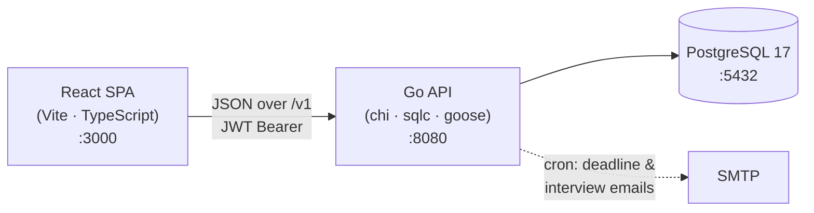

<div align="center">

# 🎓 TrackGrad

**A calm home for tracking your graduate-school applications.**

Universities, applications, faculty outreach, recommendation letters and interviews —
all in one unhurried place. Built to feel like a study journal, not a deadline machine.

[Live demo](http://138.2.100.236:3000/)

</div>

---

## Overview

TrackGrad (formerly _"Passage"_ / _Higher Studies Application Tracker_) helps prospective
grad students stay on top of the many moving parts of applying abroad:

- 🏫 **Universities** — rankings, fees, deadlines, test & transcript requirements, LOR counts
- 📄 **Applications** — per-university status, type (MS/PhD), shortlisted faculty & recommenders
- 👥 **Faculties** — professors you'd like to work with, their research areas and papers
- ✅ **Recommenders** — the people writing your letters
- ✉️ **Mails** — where each faculty conversation stands (sent / replied / vibe / interview)
- 🗓️ **Interviews** — upcoming and completed, with notes
- 📬 **Recommendation status** — per-application checklist of which letters are in
- 🔔 **Deadline & interview email reminders** — sent automatically by a background scheduler

The design language is **"Warm Paper"**: a cream-and-clay palette, soft serif headings,
quiet rows and generous whitespace. Deadlines are framed reassuringly — never with red or
urgency.

## Architecture

TrackGrad is a small monorepo: a React single-page app talking to a Go REST API backed by
PostgreSQL.



The frontend never calls raw endpoints. It goes through a small **service abstraction**, so
the backend URL/route map can change in one place without touching the app (see below).

### Repository layout

```
higher-studies-application-tracker/
├── go-server/            # Go backend — chi router, JWT auth, sqlc, goose migrations, cron mailer
├── postgresql-database/  # PostgreSQL 17 image + config
├── react-js-frontend-v2/ # TrackGrad frontend (React + Vite) — the served app
├── solid-js-frontend/    # Legacy SolidJS frontend (kept for reference, no longer served)
├── docker-compose.yml    # Full stack (db + backend + frontend)
├── docker-compose-dev.yml# Full stack with hot reload (air + vite)
└── .env                  # Shared configuration
```

## Tech stack

| Layer     | Technology |
|-----------|------------|
| Frontend  | React 18 · TypeScript · Vite · React Router · TanStack Query · Tailwind CSS · Radix UI · react-hot-toast |
| Fonts     | Newsreader (serif) · Mulish (sans), self-hosted |
| Backend   | Go 1.23 · chi · golang-jwt · sqlc · goose · robfig/cron |
| Database  | PostgreSQL 17 |
| Tooling   | Docker Compose · air (Go hot reload) |

## Quick start (Docker)

Everything runs with one command. From the repo root:

```bash
docker compose up --build
```

Then open **http://localhost:3000**. The backend serves on `:8080` and Postgres on `:5432`.

For hot-reloading development (Go via `air`, React via Vite HMR):

```bash
docker compose -f docker-compose-dev.yml up --build
```

## Local development (without Docker)

You need Node 20+, Go 1.23+, and a running PostgreSQL.

**Frontend**

```bash
cd react-js-frontend-v2
npm install
npm run dev
```

The app expects the API base URL in `VITE_BACKEND_URL` (see `react-js-frontend-v2/.env`),
which already includes the `/v1` prefix:

```
VITE_BACKEND_URL=http://localhost:8080/v1
```

**Backend**

```bash
cd go-server
goose -dir ./migrations postgres "$DB_URL" up   # apply migrations
go run .                                          # or: air
```

## Frontend tests

The React app is covered by a Vitest + React Testing Library suite (jsdom):

```bash
cd react-js-frontend-v2
npm test            # watch mode
npm run test:run    # single run
npm run coverage    # single run + coverage report (coverage/)
```

It covers the API abstraction (HTTP client, endpoint registry, services), the
TanStack-Query hooks, auth context + route guard, the UI primitives, and every
feature page/form — ~98% statement coverage.

## Configuration

Shared settings live in the root `.env`:

| Variable | Purpose |
|----------|---------|
| `DB_URL`, `DB_USERNAME`, `DB_PASSWORD`, `DB_DATABASE` | PostgreSQL connection |
| `PORT` | Backend port (default `8080`) |
| `SECRET_KEY` | JWT signing secret |
| `SMTP_EMAIL`, `SMTP_PASSWORD`, `SMTP_HOST`, `SMTP_PORT` | Outgoing reminder emails |
| `VITE_BACKEND_URL` | API base URL the frontend calls (include `/v1`) |

## API & auth

The backend exposes a JSON REST API under `/v1`. Authentication is JWT-based:

1. `GET /v1/login` with an `Authorization: <username>:<password>` header returns `{ token }`.
2. Every subsequent request sends `Authorization: Bearer <token>`.

Tokens are stored in `sessionStorage` and expire after one hour. Most read endpoints are
`POST`-with-body by design.

### The frontend service layer

The React app talks to the backend **only through a typed service layer**, so endpoints are
swappable without touching pages:

```
src/lib/api/
├── endpoints.ts   # ⭐ the single map of { method, path } for every operation
├── http.ts        # fetch client: base URL, auth header, {data} unwrap, 401 handling
├── services/      # typed methods per entity (universityService.list(), .create(), …)
└── index.ts
```

Pages and hooks depend on `services` (via TanStack Query hooks in `src/features/queries.ts`),
never on raw URLs. To point at a different backend or a renamed route, edit `endpoints.ts`
alone — the service signatures stay the same, so nothing downstream breaks.

## Frontends

The project has migrated from **SolidJS to React**. The React app in `react-js-frontend-v2/`
is the primary, served frontend. The original SolidJS app in `solid-js-frontend/` is retained
for reference and is no longer wired into Docker Compose.

## License

MIT
